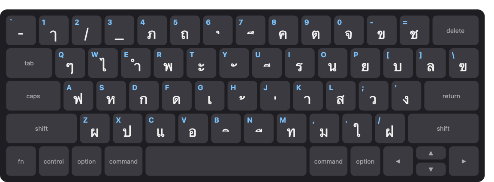
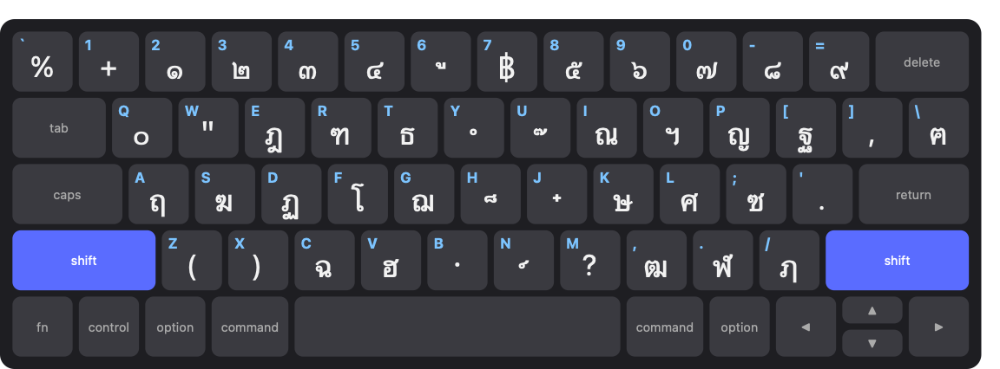

# Thai Keyboard Visualiser

A small macOS menu-bar app that shows a floating on-screen keyboard whenever
the Thai input source is active, so you can see where the Thai letters are
while you type. It lights up each key as you press it. It's a learning aid
that you build and run on your own Mac. There's no ready-made download:
sharing a pre-built app would need a paid Apple Developer ID and
notarisation, so instead each person builds it with Xcode, which is free.
On your Mac the app is called **ThaiKeyboard**.



## Install it on your Mac

You need about 30 minutes, most of it waiting for Xcode to download.

### 1. Check your Mac

- **macOS 26 or later.**
- **A Thai input source turned on.** In **System Settings → Keyboard →
  Text Input → Edit…**, click **+**, choose **Thai**, and add the layout
  you want (for example "Thai").
- The keyboard drawn is a MacBook (US/ANSI) keyboard. It still works with
  other keyboards, but the key shapes may not match yours.

### 2. Install Xcode

1. Install **Xcode** from the Mac App Store. It's free and large, so this
   takes a while.
2. Open Xcode once and let it finish installing its components.
3. Open **Terminal** (in Applications → Utilities) and accept Xcode's
   licence:

   ```
   sudo xcodebuild -license accept
   ```

   It asks for your Mac password.

### 3. Create your signing certificate

macOS only lets the app keep its Input Monitoring permission if it's
signed. A free Apple ID is enough.

1. In Xcode, open **Xcode → Settings… → Accounts**.
2. Click **+**, choose **Apple ID**, and sign in.
3. Select your account (it shows as "Personal Team"), click **Manage
   Certificates…**, click **+**, and choose **Apple Development**.
4. Check it worked. In Terminal, run:

   ```
   security find-identity -p codesigning -v
   ```

   You should see one line containing "Apple Development" and
   `1 valid identities found`.

   If it says `0 valid identities found`, your Mac is missing Apple's
   intermediate certificate. Install it with:

   ```
   curl -fsSLo /tmp/AppleWWDRCAG3.cer https://www.apple.com/certificateauthority/AppleWWDRCAG3.cer
   security add-certificates -k ~/Library/Keychains/login.keychain-db /tmp/AppleWWDRCAG3.cer
   ```

   Then run the check again.

### 4. Get the code

In Terminal:

```
cd ~/Downloads
git clone https://github.com/rcar-t/thai-keyboard-visualiser.git
cd thai-keyboard-visualiser
```

(Or on the [project page](https://github.com/rcar-t/thai-keyboard-visualiser)
click **Code → Download ZIP**, unzip it, and `cd` into the unzipped folder.)

### 5. Build and install

Still in the `thai-keyboard-visualiser` folder:

```
scripts/build-app.sh
```

This builds the app, signs it with your certificate, installs it to
`/Applications/ThaiKeyboard.app`, and starts it. A **ก** appears in the
menu bar. The app also adds itself to your login items so it starts when
you log in (you can turn that off in Settings).

### 6. Allow key presses

macOS asks whether ThaiKeyboard may monitor input. Allow it (see
[Granting Input Monitoring](#granting-input-monitoring) below).

Now switch your input source to Thai: the keyboard appears.

### Updating

```
cd ~/Downloads/thai-keyboard-visualiser
git pull
scripts/build-app.sh
```

Because it's signed with the same certificate, macOS keeps the Input
Monitoring permission.

### Uninstalling

1. Click **ก → Quit**.
2. Delete `/Applications/ThaiKeyboard.app`.
3. Optionally, remove it from **System Settings → General → Login Items**
   and **Privacy & Security → Input Monitoring**.

## Granting Input Monitoring

The app needs the Input Monitoring permission to see which key you're
pressing (only to light it up — see below). The first time it launches
without the permission, macOS prompts you; if you miss that, or need to
grant it later, go to **System Settings → Privacy & Security → Input
Monitoring** and turn ThaiKeyboard on. The app keeps working without it,
just without the key-press highlighting, and the menu bar menu tells you
when it's missing.

## Using it

A menu bar icon (ก) appears — no Dock icon. Its menu has:

- **Show/Hide keyboard** — Show always brings the keyboard up, even
  with Caps Lock on. If you're typing in another language it also
  switches the input source to Thai (the Thai source you used last).
  Hide puts it away while you keep typing, until you next switch
  input source.
- **Settings…** — font, opacity, size, hotkeys, start at login.
- **Quit** — the only way to turn the app off entirely.

Hold **Shift** and every key shows its Shift character, with both Shift
keys lit:



The keyboard hides by itself while Caps Lock is on (it would show the
wrong letters). If it seems to be missing, check Caps Lock, or turn on
"Show what Caps Lock types" in Settings.

### Default hotkeys

These work regardless of which app is focused:

- `Ctrl+Option+←/→/↑/↓` — snap the keyboard to that edge's centre.
- `Ctrl+Option+U/I/J/K` — snap to a corner (top-left/top-right/bottom-left/bottom-right).
- `Ctrl+Option+=/−` — bigger / smaller.

All of these can be changed in Settings.

### Settings

Settings lets you change the font used for the Thai characters, the
keyboard's opacity and size, how Caps Lock is shown, each hotkey, and
whether ThaiKeyboard starts automatically at login (on by default — turn it
off in Settings if you don't want that). Settings also shows a
compatibility check: your current input source, whether your keyboard
matches the layout being drawn, whether Input Monitoring is granted, and
what Caps Lock does in the active layout.


## Privacy

ThaiKeyboard watches your key presses only to light up the matching key on
screen. Nothing you type is ever logged, stored, or sent anywhere.

## For developers

Run the tests with:

```
swift test
```

`scripts/build-app.sh` builds, signs, installs and relaunches in one step;
run it after every change.

